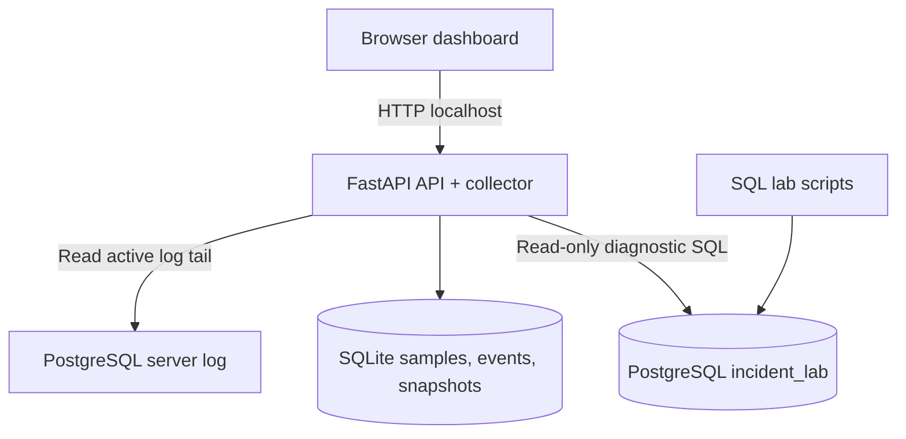

# DB Incident Replay

**A local-first PostgreSQL incident flight recorder for DBAs and database support engineers.**

DB Incident Replay connects a Python API and browser dashboard to a local PostgreSQL instance. It displays live diagnostic evidence, including active sessions, blocking relationships, and connection counts; periodically samples selected signals; stores local SQLite history; and supports manual timestamped evidence snapshots. Version 0.5 adds recent failed-SQL evidence ingestion from the active PostgreSQL server log.

> **Project status:** learning/portfolio prototype. This version is not production-ready or a complete monitoring platform. Findings are diagnostic clues, not guaranteed root-cause conclusions.

## Current capabilities

- FastAPI/Uvicorn API and browser dashboard.
- Read-only diagnostics for current activity, blocking relationships, and connection counts.
- Automatic sampling (default 15 seconds) for sessions, blockers, long-running queries, long idle-in-transaction sessions, connection distribution, and selected database counters.
- Seven-day retention of automatic samples in local SQLite; manual snapshots and event history are retained separately in this version.
- Threshold-based incident events and an incident timeline.
- Manual timestamped evidence snapshots with diagnostic payloads.
- Failed SQL ingestion from the recent tail of the active PostgreSQL log (v0.5): parses ERROR, FATAL, and PANIC entries and nearby DETAIL, HINT, and STATEMENT lines when available.
- Dashboard panel under **Database health → Failed SQL statement capture**, with ingestion status and refresh control.
- `GET /api/diagnostics/failed-queries?limit=10` endpoint.
- Optional `PG_LOG_FILE` override and `PG_LOG_TAIL_BYTES` scan limit (default 2 MiB; maximum 10 MiB).
- SQL lab scripts for reproducing a blocking incident.

## Known limitations

- Only the active log file's recent tail is scanned; rotated/archived logs are not ingested.
- Multiline statement association and historical coverage are not guaranteed. Polling can miss events shorter than the sampling interval.
- This is not a complete audit trail, full query-performance root-cause analyzer, or automated remediation tool.
- No multi-tenant authentication, enterprise secret management, or production deployment hardening.

## Architecture



The browser does not connect directly to PostgreSQL. Keep the API bound to `127.0.0.1`; do not expose this prototype to the internet.

## Requirements

- macOS, Linux, or Windows
- Python 3.10+ (Python 3.11/3.12 recommended)
- Local PostgreSQL and `psql` or pgAdmin
- Git (optional, for development)

## Quick start — macOS/Linux

1. Install PostgreSQL from the [official download page](https://www.postgresql.org/download/).
2. As a local PostgreSQL administrator, run `CREATE DATABASE incident_lab;` by itself from `sql/01_setup.sql` (or create the database through pgAdmin).
3. Connect to `incident_lab` and run the remaining role/table/grant statements in `sql/01_setup.sql`. Review the SQL before executing it and set a strong local password instead of the placeholder.
4. Copy `.env.example` to `.env`; set `DB_PASSWORD` to the password for `incident_reader` and adjust connection values for your local installation. Never commit `.env`.
5. From the project root:

   ```bash
   python3 -m venv .venv
   source .venv/bin/activate
   python3 -m pip install -r requirements.txt
   python3 -m uvicorn app.main:app --host 127.0.0.1 --port 8000
   ```

6. Open [http://127.0.0.1:8000](http://127.0.0.1:8000). API docs are available at [http://127.0.0.1:8000/docs](http://127.0.0.1:8000/docs).
7. Open **Database health** and find **Failed SQL statement capture**. Click **Refresh logs** to check ingestion status.

Documentation Link : https://pgsql-sphinx-docs.readthedocs.io/en/latest/


### Windows PowerShell

```powershell
py -m venv .venv
.\.venv\Scripts\Activate.ps1
python -m pip install -r requirements.txt
python -m uvicorn app.main:app --host 127.0.0.1 --port 8000
```

If PowerShell activation is blocked, use Command Prompt with `.venv\Scriptsctivate.bat`.

## PostgreSQL role creation and permissions

Run the setup SQL as a PostgreSQL administrator, not as the application user. The supplied `sql/01_setup.sql` creates the `incident_reader` login, grants connection and demo-table access, and grants the monitoring permissions used by this local prototype. Review the exact permissions against the app's query requirements before reusing them elsewhere.

The v0.5 failed-log discovery calls `pg_catalog.pg_current_logfile()`. Depending on PostgreSQL version and role configuration, the application login may need permission to execute that function and monitoring privileges. The local lab setup includes:

```sql
GRANT pg_monitor TO incident_reader;
GRANT EXECUTE ON FUNCTION pg_catalog.pg_current_logfile() TO incident_reader;
```

`pg_monitor` is a predefined monitoring role with broader visibility than a simple table reader. Grant it only to a trusted local lab account after reviewing its implications. Do not use a superuser login for routine application monitoring. The application process must also be able to read the selected log file at the operating-system level if it reads the file directly; do not make PostgreSQL logs world-readable to solve access problems.

## Configure PostgreSQL server logging

The server must log errors for failed SQL to be captured. Review [`docs/postgres-logging.md`](docs/postgres-logging.md) and your installed PostgreSQL version before changing settings. Typical local-lab settings include:

```conf
logging_collector = on
log_destination = 'stderr'
log_directory = 'log'
log_filename = 'postgresql-%Y-%m-%d_%H%M%S.log'
log_min_error_statement = error
log_line_prefix = '%m [%p] user=%u db=%d app=%a client=%h '
```

`logging_collector` generally requires a restart when changed; other settings may be reloadable. Check `pg_settings` and the documentation for your version. Do not blindly apply settings to production. SQL/error logs may contain secrets or personal data; limit access, retention, and sharing.

If active log discovery is unavailable, set `PG_LOG_FILE` in `.env` to an absolute path that the application process can read. `PG_LOG_TAIL_BYTES` controls the recent-tail scan size. Restart the API after changing `.env`.

## Verify failed-SQL ingestion (v0.5)

1. Start PostgreSQL with server error logging configured and start the API.
2. In a test database session, run a harmless failing query against a nonexistent table:

   ```sql
   SELECT * FROM incident_replay_test_table_missing;
   ```

3. Request recent parsed errors:

   ```bash
   curl -s "http://127.0.0.1:8000/api/diagnostics/failed-queries?limit=10"
   ```

4. Confirm the response has `"status":"ok"`, `"ingestion_enabled":true`, and an item containing `incident_replay_test_table_missing`.
5. In the dashboard, open **Database health → Failed SQL statement capture** and click **Refresh logs**.

The endpoint may include SQL literals. Keep it local/private and sanitize output before sharing it. This parser reads the active log's recent tail only; it does not guarantee complete history or robust parsing of all multiline statements.

## Automatic sampling and incident history (v0.4)

- `AUTO_MONITOR=true` enables the background collector.
- `MONITOR_INTERVAL_SECONDS` controls the interval (default 15 seconds; minimum 10 seconds).
- `LONG_QUERY_SECONDS` is the long-running query threshold (default 30 seconds).
- `IDLE_TXN_SECONDS` is the idle-in-transaction threshold (default 60 seconds).
- Automatic samples are retained for seven days in `data/incident_history.sqlite3`; manual snapshots and event history are not pruned automatically in this version.
- API routes include `/api/monitor/status`, `/api/monitor/latest`, `/api/monitor/history`, and `/api/events`.

## First demo: reproduce a blocking incident

See [`docs/incident-scenarios.md`](docs/incident-scenarios.md). In summary, use two sessions: in Session A begin a transaction and update `demo_accounts.account_id = 1` without committing; in Session B update the same row and leave it waiting. Run dashboard diagnostics and capture evidence, then `COMMIT;` in Session A and confirm the waiting update finishes. Use only the disposable synthetic lab database.

## Troubleshooting

See [`docs/troubleshooting.md`](docs/troubleshooting.md). Common issues include connection refused, password authentication failures, missing roles/database, missing Python modules, inability to discover/read the active log, and permission errors for `pg_current_logfile()`.

## Security and data handling

- Use only a disposable local database with synthetic data.
- `.env`, `.venv/`, Python caches, logs, and local `data/` evidence are ignored by Git. Never commit passwords, customer data, production logs, tokens, or private hostnames.
- Keep the API bound to `127.0.0.1`; do not expose it publicly.
- SQL text, error details, connection metadata, and SQLite history can contain sensitive information. Review/redact before sharing.
- Do not connect this prototype to employer/customer production systems without explicit authorization and a security review.
- See [`SECURITY.md`](SECURITY.md).

## Roadmap

See [`docs/roadmap.md`](docs/roadmap.md). Implemented capabilities include periodic sampling, local incident history, manual snapshots, the timeline, and v0.5 failed-SQL ingestion. Potential future work includes rotated-log ingestion, stronger SQL redaction, richer incident replay, and retention controls.

## Demo evidence for your portfolio

Add sanitized screenshots under `docs/screenshots/`: dashboard before the incident, blocked session, blocker/blocked PIDs, independent PostgreSQL verification, and dashboard after the blocker clears. Use only synthetic lab data.

## Technology stack

- PostgreSQL and SQL
- Python, FastAPI, Uvicorn
- HTML, CSS, JavaScript
- SQLite, Git, and GitHub

## License

MIT License. See [`LICENSE`](LICENSE).

## Author

**Kiran Kambale** — PostgreSQL Database Engineer / Database Support

This is an independent portfolio project and is not affiliated with or endorsed by any employer.
