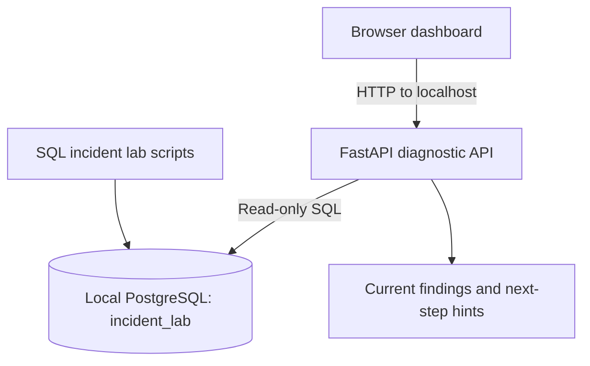

# DB Incident Replay

**A local-first PostgreSQL incident investigation lab for DBAs and database support engineers.**

DB Incident Replay connects a small Python API and browser dashboard to a local PostgreSQL instance and displays selected live diagnostic evidence, including active sessions, blocking relationships, and connection counts. The included SQL scripts let you reproduce a blocking incident safely in a disposable local database.

> **Project status:** learning/portfolio prototype. This version is not production-ready, is not a complete monitoring platform, and does not reconstruct past incidents unless evidence was captured at the time. Findings are diagnostic clues—not guaranteed root-cause conclusions.

## Why this project exists

PostgreSQL support engineers often need to turn symptoms such as slow queries or blocked transactions into a repeatable investigation. This project demonstrates a workflow for collecting database evidence, checking it against PostgreSQL, and documenting a likely next step.

## Current capabilities

- Local Python API using FastAPI/Uvicorn.
- Browser-based dashboard.
- Read-only diagnostic queries for current activity, blocking relationships, and connection counts.
- Evidence-backed guidance for some lock scenarios.
- SQL lab scripts for a reproducible lock incident.
- Setup and troubleshooting instructions for macOS/Linux and Windows.

## Not implemented in this version

- Persistent incident snapshots/history or true historical replay.
- Full query-performance root-cause analysis.
- Server-wide connection exhaustion detection in every deployment configuration.
- Automated integration with `pg_cron`, pgBadger, pgBackRest, or a Flight Recorder extension.
- Multi-tenant authentication, audit controls, enterprise secret management, or production deployment hardening.
- Automatic remediation. The app must not be treated as an automated production DBA.

## Architecture



The browser does not connect directly to PostgreSQL. The Python API uses database credentials from a local `.env` file. Keep this prototype bound to `127.0.0.1` and never expose it to the internet.

## Requirements

- macOS, Linux, or Windows
- Python 3.10+ (Python 3.11/3.12 recommended)
- A local PostgreSQL installation
- pgAdmin or `psql`
- Git for publishing changes

## Quick start — macOS/Linux

1. Install PostgreSQL from the [official download page](https://www.postgresql.org/download/).
2. Open pgAdmin and connect to your local PostgreSQL server as an administrator.
3. Open `sql/01_setup.sql`. Execute `CREATE DATABASE incident_lab;` by itself first.
4. Connect to the `incident_lab` database, then execute the rest of `sql/01_setup.sql` beginning at `CREATE ROLE`. Do not run `CREATE DATABASE` again while connected to `incident_lab`.
5. Copy `.env.example` to `.env` and set `DB_PASSWORD` to the password assigned to `incident_reader` in the setup SQL.
6. From the project root, run:

   ```bash
   python3 -m venv .venv
   source .venv/bin/activate
   python3 -m pip install -r requirements.txt
   python3 -m uvicorn app.main:app --host 127.0.0.1 --port 8000
   ```

7. Open [http://127.0.0.1:8000](http://127.0.0.1:8000) and click **Run diagnostics**.
8. Optional API documentation: [http://127.0.0.1:8000/docs](http://127.0.0.1:8000/docs).

### Windows PowerShell

```powershell
py -m venv .venv
.\.venv\Scripts\Activate.ps1
python -m pip install -r requirements.txt
python -m uvicorn app.main:app --host 127.0.0.1 --port 8000
```

If PowerShell activation is blocked, use Command Prompt with `.venv\Scripts\activate.bat`. Do not use Windows activation commands in macOS/Linux terminals.

## First demo: reproduce a blocking incident

Follow the complete procedure in [`docs/incident-scenarios.md`](docs/incident-scenarios.md). In short:

1. Open two SQL sessions connected to `incident_lab`.
2. In Session A, run `BEGIN;` and update `demo_accounts.account_id = 1`. Leave the transaction open.
3. In Session B, update the same row. It should wait for Session A.
4. Click **Run diagnostics** in the dashboard while Session B is waiting.
5. Compare the blocker and blocked PIDs with the independent SQL verification query in the scenario guide.
6. Run `COMMIT;` in Session A and confirm Session B finishes.

## Other local scenarios

See [`docs/incident-scenarios.md`](docs/incident-scenarios.md) for:

- Active query visibility with `pg_sleep`.
- An open / idle-in-transaction session.
- How to think about connection pressure and replication lag, including what this version can and cannot validate.

## Troubleshooting

See [`docs/troubleshooting.md`](docs/troubleshooting.md) for common errors including connection refused, password authentication failure, missing roles/database, permission issues, and missing Python modules.

## Security and data handling

- Use only a disposable local database with synthetic data.
- `.env`, `.venv/`, and Python cache files are ignored by Git. Never commit passwords, customer data, production logs, tokens, or private hostnames.
- The API is intended to bind to `127.0.0.1`; do not expose it publicly.
- The database reader requires appropriate privileges to see activity/blocking details. Review and minimize permissions for any future environment.
- Do not connect this prototype to employer or customer production systems without explicit authorization and a security review.
- See [`SECURITY.md`](SECURITY.md).

## Roadmap

Priorities and current status are documented in [`docs/roadmap.md`](docs/roadmap.md). The recommended next milestone is timestamped evidence snapshots and an incident history view.

## Demo evidence for your portfolio

After reproducing a scenario, add your own sanitized screenshots under `docs/screenshots/` and link them here. Capture:

1. Dashboard before the incident.
2. Session B waiting on a lock.
3. Dashboard showing blocker and blocked PIDs.
4. PostgreSQL verification query output.
5. Dashboard after Session A commits.

Only use your local synthetic lab data. Do not publish customer or employer screenshots.

## Technology stack

- PostgreSQL and SQL
- Python, FastAPI, Uvicorn
- HTML, CSS, JavaScript
- Git and GitHub

## License

MIT License. See [`LICENSE`](LICENSE).

## Author

**Kiran Kambale** — PostgreSQL Database Engineer / Database Support

This is an independent portfolio project and is not affiliated with or endorsed by any employer.
