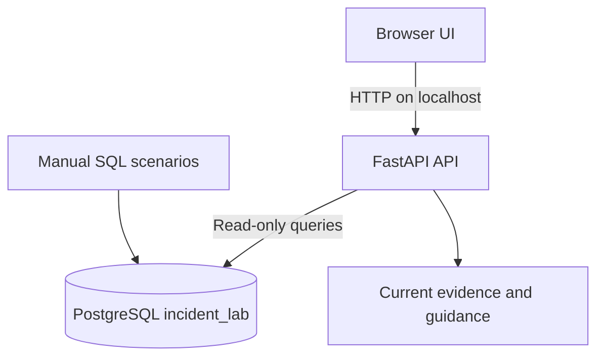

# Architecture and Design Notes

## Current prototype

## Design principles

- Local-first and synthetic data for the portfolio demo.
- Keep database credentials on the server side in `.env`; never in browser JavaScript.
- Use a dedicated reader role rather than a database superuser for the app.
- Use short query timeouts and read-only access where supported by the implementation.
- Treat findings as clues. Root-cause conclusions require corroborating evidence.
- Do not perform automatic remediation.

## Future architecture (not yet implemented)

A future version could collect timestamped snapshots into a dedicated incident store, associate them with a ticket/time window, and compare evidence over time. Any deployment beyond localhost would require authentication, authorization, secret management, TLS, audit logging, input validation, rate limiting, safe tenant isolation, and a documented security review.
